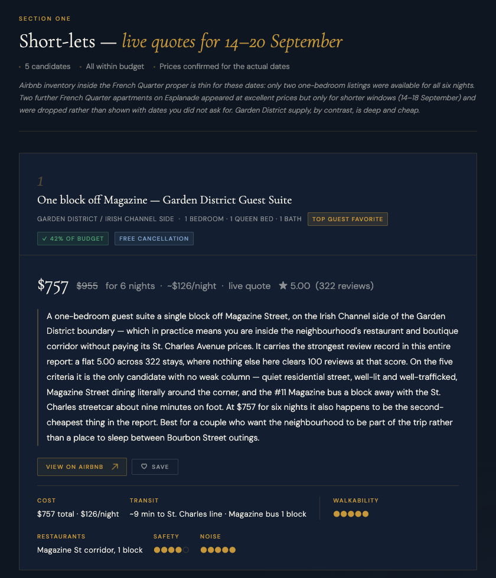

# lodging-compare

Anyone can list hotels. The hard part of booking a place to stay is deciding
between a $260 hotel on a loud street, and a $126 apartment twenty minutes out. Especially if there are a handful of specific things you really care about.

The `lodging-compare` skill helps with your decision-making. It finds candidates across more than one accommodation type — hotels, short-let apartments, aparthotels, hostels — scores each against the criteria you named, and commits to a ranked opinion with reasons. It is read-only: it never books, reserves, holds, or pays for anything.



_The top-ranked candidate from the run below — a live quote for the exact dates, the case for it, and the criteria it was scored on._

## A real run

The prompt:

> Use the lodging-compare skill. Destination: New Orleans, Louisiana, USA.
> Areas: French Quarter and Garden District. Check-in 2026-09-14, check-out
> 2026-09-20. 2 guests, minimum 1 bedroom. Budget 1800 USD total. Include
> short_let and hotel.

Seven minutes later, ten candidates in the report above — five short-lets with
live Airbnb quotes for those exact dates, five hotels — and a verdict:

> **Top pick:** the Garden District guest suite one block off Magazine —
> **$757 for six nights**, 5.00 across 322 reviews, the only candidate with no
> weak column on your five criteria, at 42% of budget.

The useful part is what the skill argued, not what it found. The trade-off in New
Orleans turned out not to be space-versus-service but noise: every French
Quarter candidate was compromised on a criterion that had been named, and the
Garden District is a $1.25 streetcar ride away.

It also flagged two things nobody asked about — that the hotel totals exclude ~16.35% tax plus a $3/night fee, and that mid-September is the statistical peak of hurricane season. So the free-cancellation rates are worth their premium.

The skill noted that the hotel prices were typical rates rather than quotes for
those dates, and marked every one of them on the card. No aggregator will serve
dated hotel pricing to an automated session; the skill prefers to show you an estimate over trying to guess a wrong number.

## Install

```
/plugin marketplace add avoision/skills
/plugin install lodging-compare@avoision-skills
```

Or copy the `lodging-compare/` folder into `~/.claude/skills/`.

### What it needs from the host

Plain Agent Skills format, so it loads anywhere skills do — but it is a research skill and needs the tools to do research:

|                    |                                                                                                                        |
| ------------------ | ---------------------------------------------------------------------------------------------------------------------- |
| **Web search**     | required — every accommodation type starts from search                                                                 |
| **Shell**          | required for live pricing; also how it finds a browser                                                                 |
| **File write**     | only if you want the HTML report                                                                                       |
| **Browser driver** | optional, strongly recommended — built and measured against `playwright-cli` on `PATH`. Live short-let quotes need one |

Without a browser the skill still runs, returns estimated prices, and tells you
that is what happened. Without search it cannot do anything useful. It was
built and measured in Claude Code; a couple of tool names in `references/` are
Claude's, and the equivalents elsewhere work the same way.

## What it does

- **Compares across types, not within one.** A hotel and an apartment answer
  the same question differently. Ranking them in the same list is the point.
- **Scores against your criteria.** Walkability, safety, transit, restaurants,
  and noise by default — replace them with anything you can research.
- **Ranks by fit, not by price.** Price is one criterion. It is never the sort
  key.
- **Answers agents as readily as people.** Every parameter can be passed up
  front; only destination and dates are unresolvable. Anything else defaults,
  and the default is recorded as an assumption in the output. A calling agent
  is never asked a question.
- **Degrades instead of failing.** A blocked source returns partial results
  plus a warning. Thin output that does not say it is thin is the failure mode
  this is built to avoid.
- **Returns JSON, an HTML report, or both.** Agents get JSON by default,
  people get the report.

## What it won't do

- **Book anything.** No reservations, no holds, no payments, no forms. This
  boundary is what makes the skill safe for another agent to call.
- **Quote hotel prices for your dates.** They are typical rates, marked as
  estimates. Short-let prices at standard depth are live quotes.
- **Watch prices over time.** Every result is a snapshot at run time.
- **Flights, trains, or car hire.** Lodging only.

## Cost

A standard run makes **6–16 retrieval calls, takes 7–10 minutes, and produces
27–34k output tokens** — worth knowing before you or an agent call it in a
loop.

Priced at API list rates that came to about **$2.35 on Claude Opus 5**
(measured 2026-08-27), and roughly 40% of that on Sonnet 5. If you run it
inside a Pro or Max subscription you are not billed per token — the cost you
feel is usage-window share, and this is a heavy enough run to notice.

The `depth: quick` parameter skips the browser and the live-quote step for a cheaper,
estimates-only answer. Every run announces its own depth, scope, and rough cost
in one line before it starts working.

The full measurements are in `SKILL.md`.

## Full reference

`SKILL.md` carries the parameter table, the criteria, the depth tiers, and the
ranking rule. `references/` holds the per-source search strategies, the JSON
schema, and the report template.

## License

MIT
