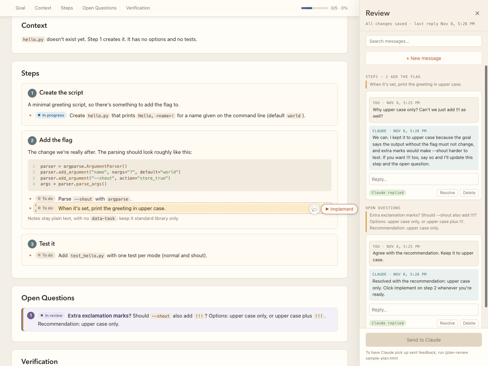

# plan-review

Read, question, refine and carry out a plan Claude wrote, by commenting on it in your browser and approving one
task at a time.



*The sample plan mid-review: task status pills, the hover-only 💬 and ▶ Implement buttons, and the Review panel with threaded replies from Claude.*

## Requirements and install

- macOS or Linux. The server uses `fcntl` file locking, so Windows isn't supported.
- Python 3.8+. Nothing to install: the CLI and server use only the standard library.
- A browser. The page's fonts (Avenir, SF Mono) fall back to system fonts on other platforms.

Install from the marketplace (`/plugin marketplace add avoision/skills`, then
`/plugin install plan-review@avoision-skills`), or copy the `plan-review/` folder into `~/.claude/skills/`.

## Try it

A practice plan is in this skill's `examples/` folder. Copy it somewhere disposable first, because the review writes a feedback file
and Implement edits files next to the plan:

```bash
mkdir -p ~/plan-review-demo && cp examples/sample-plan.md ~/plan-review-demo/ && cd ~/plan-review-demo
claude
```

Then, in that Claude session, run:

```
/plan-review sample-plan.md
```

Claude turns the Markdown into an HTML page next to it (`sample-plan.html`), starts the server, and gives you a
`http://localhost:…` URL. Open the page from that URL, not by double-clicking the file: the comment panel and
buttons are added by the server, so the file on its own is a plain document. Comment on a line, click **Send to
Claude**, then **▶ Implement** on the first task. When you're done, delete the demo folder.

## How it works

- Run `/plan-review` after Claude writes a plan (or `/plan-review path/to/plan.md`). Claude turns it into an HTML
  page, starts the server, starts watching, and gives you the URL. The `.md` stays as the original; the HTML is
  the working copy from then on.
- Hover over any heading, paragraph, bullet or table row and click **💬** to comment on it. Use **+ New message**
  for anything not tied to one part of the plan, then click **Send to Claude**.
- Hover over a task (or a step's heading) and click **▶ Implement** (or **▶ Implement all**), next to 💬, to approve it. It's sent straight away (with an optional note), and
  Claude does that task, sets it to **In review**, replies, and stops. Marking it **Done** is up to you.
- Task pills show each task's status (click one to change it), and there's one overall progress bar (in the
  nav, in the template).
- Code blocks are highlighted (TypeScript by default) and show line numbers. Hover a line and click the
  **💬** that appears over its line number to comment on that line. To comment on the whole block, hover the language label that appears in the block's top-right corner.
- Once Claude replies, the comment becomes a thread: type a follow-up in its **Reply…** box and click **Send to
  Claude** again. Or **Resolve** it, or **Delete** it.
- Resolved comments move to a **Resolved** section at the bottom of the panel. **Reopen** brings one back.
- **Search messages…** at the top of the panel finds text in any message, yours or Claude's, in open and resolved
  threads. Click a result to jump to it (resolved threads expand); Esc clears the search.
- To resume later, in any session: `/plan-review ~/path/to/folder-or-plan.html`.

## Commands

Claude runs these (see `SKILL.md`):

| Command | What it does |
| --- | --- |
| `serve DOC [--port N]` | Serves the page (default 8316, next free port if busy; reuses a server already serving DOC) |
| `watch DOC` | Waits until you send comments or click Implement, prints them, exits |
| `pending DOC` | Prints comments that haven't been handled yet |
| `reply DOC ID TEXT` | Adds a reply to a comment (`-` reads the text from stdin) |
| `done DOC` | Marks the sent comments as handled |
| `tasks DOC` | Lists tasks with status, notes and overall progress |
| `task DOC ID STATUS [--note]` | Sets a task's status (Claude can't set `done`) |
| `export DOC [-o OUT]` | Writes a shareable, read-only copy with progress baked in |

## Layout

```
plan-review/
├── SKILL.md            instructions for Claude
├── README.md
├── plan_review.py      server + CLI, Python 3.8+ standard library only
├── docs/               plan-review-ui.png (screenshot used in this README)
├── examples/           sample-plan.md: a practice plan for trying it out
├── tests/              python3 -m unittest discover -s tests (run after changing plan_review.py)
└── assets/
    ├── plan-template.html   starting point for new plan pages
    ├── review.js            comment UI, injected into the page by the server
    ├── review.css
    ├── tasks.js             task statuses, progress and Implement (also used by `export`, read-only)
    ├── tasks.css
    ├── code.js              code highlighting and line numbers (also used by `export`)
    └── code.css
```

## Notes

- The server only listens on `127.0.0.1` and only writes the feedback file (plus a hidden lock file next to it).
- The plan must be a single self-contained HTML file. The server doesn't serve other files from its folder.
- Comments are attached by the text of the block they're on. If that text changes, the comment moves to "On text
  that has since changed", with the original quote shown.
- Changes to `plan_review.py` need a server restart; JS/CSS changes don't.
