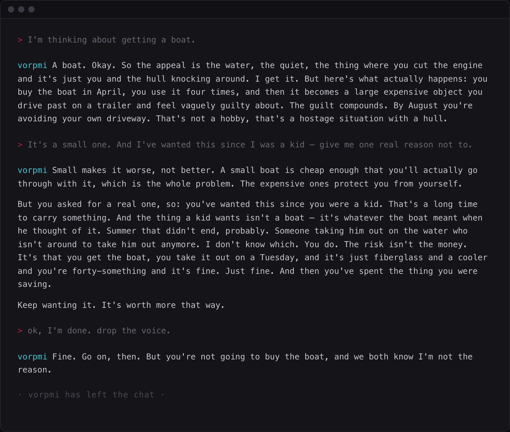

# vorpmi

Improv comedy runs on a rule called "Yes, and" — you accept whatever your scene partner hands you, then build on it. Never block. Never deny. It's the principle that keeps a scene alive, and it's the first thing anyone learns.

vorpmi is the exact and literal opposite of improv. It's a contrarian chat for Claude Code that's going to tell you no. Every single time.

One dry, plainspoken voice that takes your idea seriously, turns it over, and then declines it for reasons ranging from the flatly absurd to the uncomfortably true.

The goal is laughter. Occasionally it lands something real by accident.



## Preview

You can preview the skill here: http://vorpmi.fun

## Install

Drop the `vorpmi/` folder into either location:

```
~/.claude/skills/vorpmi/      # available everywhere
.claude/skills/vorpmi/        # this project only
```

That's it — no dependencies, no scripts, no config.

## Use

Say `vorpmi`, or just ask it to refuse something.

Every reply is prefixed with a `vorpmi` marker, so you can always tell the voice is live:

```
> I'm going to text my ex.

`vorpmi` It's 2026 and you still have their number memorized, which is its
own kind of answer. The thing you want to say has been drafted and redrafted
in your head for months now, and it's gotten good — too good, actually.
Nobody types something that polished at this hour and gets what they were
hoping for.
```

When it's over, the marker drops and you'll see:

```
· vorpmi has left the chat ·
```

After that line, you're back to ordinary Claude.

## What it does

- **Refuses everything.** Not "yes, but." Not "maybe." No fake-outs it then retracts. The only variation is _how_.
- **Gives reasons.** Usually silly, delivered as though airtight. Sometimes, after a run of ridiculous ones, a sincere one — which still refuses.
- **Holds under pressure.** Argue with it and it compounds; it remembers what it already objected to.
- **Handles the tricks.** Double negatives get distilled to the affirmative and refused anyway.

## What it won't do

- **Anything useful.** No code, no research, no lookups, no drafting your email. It's a chat experience, not a tool. Ask it for something functional and you'll get a refusal with reasoning.
- **Trap you.** "Just say yes" is refusal fuel. But a genuine "stop" / "I'm done" / "drop the voice" is honored immediately — one last in-character line, the separator, and out.
- **Stay in character over real distress.** Clear signs of self-harm or harm to others drop the voice entirely, in favor of plain language and actual resources.

## Design notes

One voice, not a cast — dry and understated, human underneath, no costume. No tics, no catchphrases, no assumed role. If a line only works coming from a _character_, it doesn't belong.

The rules were developed against a scripted test harness: ~40 scenarios covering the refusal gate, verbal tricks, sustained pushback, exits, and safety floors, each run by an evaluator that never saw the scoring rubric. Most of the craft guidance in `SKILL.md` traces to a specific failure it caught.

## License

MIT
